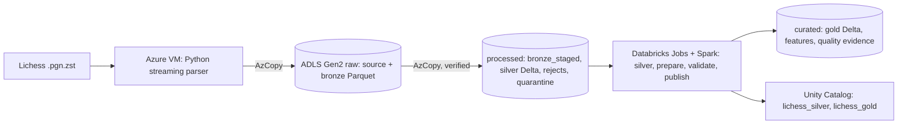

# DSAI3202: Lichess game-outcome prediction on Azure (Phase 1 and Phase 2)

Student: Rizan Mohammed (60306369), individual project  
Repository: https://github.com/rizan-mohammed/dsai3202-lichess  
Phase 1 release: Git tag `phase1-submission` (the commit it points to is the Phase 1 submitted version)  
Phase 2 release: Git tag `phase2-final` (the commit it points to is the Phase 2 submitted version)  
Instructor access: the instructor is added as a collaborator on this repository

Contents: Phase 1 (data pipeline, below) and Phase 2 (model, validation, registration and deployment, starting at "Phase 2: Model, validation, registration and deployment").

---

# Phase 1: Lichess game-outcome data pipeline on Azure

## Project and hypothesis

**Problem.** Predict the result of a Lichess game (White win, draw, Black win) after the first 10 moves per player (20 plies), using only information available at that point.

**Target.** `label`: 0 = White wins (`1-0`), 1 = draw (`1/2-1/2`), 2 = Black wins (`0-1`).

**Hypothesis (Phase 0).** H1: a gradient-boosted classifier using ratings, time control, ECO/opening and early clock usage achieves lower multiclass log loss than a rating-only logistic regression on later, unseen games (improvement of at least 0.005 with a bootstrap 95% CI excluding 0). H0: these extra features give no measurable improvement.

**Baseline plan.** Majority class, multinomial logistic regression on `elo_diff`, rating-only gradient boosting, then feature-group ablations. Chronological split (earlier games train, later games test) using `game_ts`.

**Approved refinements.** None so far.

**Scope note.** The Phase 0 secondary timing experiment (5, 10 and 15 moves per player) is not part of this project's deliverables. Bronze keeps the first 20 plies, so checkpoints beyond move 10 are not available. The main hypothesis at move 10 (20 plies) is unchanged.

## Dataset and architecture

| Item | Value |
|---|---|
| Source | Lichess Open Database, standard rated games, May 2017: https://database.lichess.org/standard/lichess_db_standard_rated_2017-05.pgn.zst |
| Format | PGN compressed with Zstandard (`.pgn.zst`) |
| Compressed size | 3,585,539,491 bytes (3.34 GiB) |
| Games | 11,693,919 parsed (0 unparseable) |
| SHA-256 | `c4b2e39a382fb8a9dc5e766bbae0201d123c5c0ccc27f6e852d9a69e6661ab2f` |
| Source ETag / Last-Modified | `"63657a0d-d5b6fda3"` / Fri, 04 Nov 2022 20:46:05 GMT |
| Ingestion mode | Batch, started manually; refresh strategy: one new monthly file per run (new versioned raw path and manifest) |
| Uncompressed size | Larger than the 3.34 GiB compressed file, so the roughly 1 GB requirement is met; all 11,693,919 games were ingested and profiled |
| Data access | Azure Storage account `amazonlake60306369` (resource group `rg-dsai3202-rizan-60306369`), containers `raw`, `processed`, `curated`; reading needs the Storage Blob Data Reader (or Contributor) role and `az login`. The data is not in Git; the source manifest with its hash is in `evidence/ingestion/source-manifest.json` |

### Architecture



| Service | Role |
|---|---|
| Azure VM (Ubuntu) | Receives the 3.3 GiB file, hashes it, parses PGN in one streaming pass into Parquet |
| ADLS Gen2 (`amazonlake60306369`) | `raw`: source and bronze (as received/parsed). `processed`: silver and per-run work. `curated`: gold, features, evidence |
| AzCopy | Idempotent uploads (`--overwrite=false`) |
| Azure Databricks (Jobs, Spark) | The four-task ETL and quality gate |
| Unity Catalog | Registers `lichess_silver` and `lichess_gold` |

**Why a bronze copy in processed?** Bronze is in `raw` as the lecture defines. The Databricks compute cannot read `raw` (`INSUFFICIENT_PERMISSIONS`), so a verified copy sits in `processed/lichess/bronze_staged/`, the same pattern as Lab-4 (raw to processed) then Lab-5.

### Storage layout

```
raw/lichess/standard_rated/2017-05/   lichess_db_standard_rated_2017-05.pgn.zst, source-manifest.json
raw/lichess/bronze/month=2017-05/     part-00000..00058.parquet (59), _bronze-manifest.json
processed/lichess/bronze_staged/month=2017-05/   copy of bronze + _source-manifest.json
processed/lichess_silver/                         Delta (table lichess_silver)
processed/lichess_silver_rejects/run_id=<uuid>/   rejected games with reason and raw record
processed/lichess_runs/<job run id>/              input copy, quarantine
curated/lichess_gold/                             Delta (table lichess_gold), current
curated/lichess_features_v1/                      Parquet, current
curated/lichess_runs/<job run id>/                gold, features per run
curated/quality/lichess_runs/<job run id>/        input.json profile.json gate.json coverage.json comparison.json success.json
curated/quality/lichess_drop_report.json          silver report
```

## Schema, keys and assumptions (silver / gold)

Key: `game_id` (Lichess id from the `Site` header), unique per game (0 duplicates found).

| Column | Type | Meaning |
|---|---|---|
| game_id | string | Lichess game id (key) |
| event | string | Event header (rated game type or tournament) |
| result | string | `1-0`, `0-1`, `1/2-1/2` (target source; never a feature) |
| utc_date | string | Game date `YYYY.MM.DD` |
| game_ts | timestamp | Start time (UTC) from UTCDate + UTCTime |
| white_elo, black_elo | int | Ratings before the game |
| white_diff, black_diff | int | Rating change after the game (leakage; never a feature) |
| eco, opening | string | Opening code and name |
| time_control | string | `base+increment` seconds, or `-` for untimed |
| tc_base, tc_inc | int | Parsed time control |
| termination | string | How the game ended (leakage; never a feature) |
| n_plies | int | Total plies in the game (leakage; never a feature) |
| moves20 | array<string> | First 20 plies (SAN) |
| clocks20 | array<int> | Seconds left after each of those plies |
| label (gold only) | int | 0 White win, 1 draw, 2 Black win |

Assumptions: the monthly file also holds a few hours of the previous month (`outside_month`, quarantined); a game's opening name is assigned by Lichess from the moves, so a few deep opening names may reflect moves beyond ply 20 (leakage risk, see below).

### Lineage

source `.pgn.zst` (sha256 in `source-manifest.json`) -> `parse_lichess.py` -> bronze Parquet (`_bronze-manifest.json`: 11,693,919 games) -> staged copy (byte sizes verified) -> `lichess_silver` (drop report: 11,687,692 rows) -> run input copy (`input.json`) -> `lichess_gold` + `features_v1` (`success.json`). `success.json` carries `source_sha256` and `bronze_games_parsed`.

## Run the pipeline

**Prerequisites.** Azure subscription with the lab resource group and lake; the Lab-2 VM; Databricks workspace with Unity Catalog (`dsai3202_databricks.s_60306369`); the instructor-granted data roles. `pip install -r requirements.txt` on the VM (`zstandard`, `pyarrow`).

**1. Ingest (VM).** Copy the `.zst` to the VM (`scp`), then:

```bash
mkdir -p ~/Lab-Phase1/{src,evidence,bronze}; cd ~/Lab-Phase1
sha256sum src/lichess_db_standard_rated_2017-05.pgn.zst | tee evidence/source.sha256
# write evidence/source-manifest.json (url, bytes, sha256, ETag, Last-Modified); then:
export AZCOPY_AUTO_LOGIN_TYPE=AZCLI; source ~/.config/dsai3202/lab3.env
B="https://$SA.blob.core.windows.net/raw/lichess/standard_rated/2017-05"
azcopy copy src/*.zst "$B/" --overwrite=false ; azcopy copy evidence/source-manifest.json "$B/" --overwrite=false
python3 -m venv .venv && .venv/bin/pip install -r requirements.txt
nohup .venv/bin/python src/ingest/parse_lichess.py src/lichess_db_standard_rated_2017-05.pgn.zst bronze/month=2017-05 > evidence/parse.log 2>&1 &
# upload bronze to raw, then the staged copy to processed (same azcopy --overwrite=false), then verify sizes
```

Verification and retry evidence is in `evidence/ingestion/` (hash round-trip, receipts before/after, `SIZES MATCH`, `STAGED MATCHES RAW`).

**2. ETL (Databricks).** Import `notebooks/lichess_*.py` into one workspace folder. Run `lichess_00_common` once. Create a job with four notebook tasks on one compute, no retries, no schedule, concurrency 1:

| Task | Notebook | Depends on (Run if) |
|---|---|---|
| silver | `lichess_01_silver` | none |
| prepare | `lichess_02_prepare` | silver (all succeeded) |
| validate | `lichess_03_validate` | prepare (all succeeded) |
| publish | `lichess_04_publish` | validate (all succeeded) |

Job parameters: `lake=amazonlake60306369`, `catalog=dsai3202_databricks`, `schema=s_60306369`, `run_id={{job.run_id}}`, `month=2017-05`, `test_bad_data=false`, `compare_to=` (empty). Exported configuration: `job/job-export.json`. Safe rerun: Run now with different parameters, `compare_to=<successful run id>`. Controlled failure: `test_bad_data=true`.

**3. Inspect.** `lichess_05_inspect` reads the saved evidence (cells 3.1 to 6.1).

## Results and features

### Runs

| Purpose | Job run ID | Outcome |
|---|---|---|
| Success | `1022222200504518` | All four tasks passed; published |
| Safe rerun | `681959495558867` | `SAME CONTENT`: gold and features identical to the success run (11,129,109 rows) |
| Controlled failure | `1040472147064037` | `test_bad_data=true` builds a separate test input (a copy of the saved input with one result changed to `2-0`, inside this run only); gate failed on `result`; publish did not run; `BLOCKED SAFELY` (published gold version and contents unchanged) |
| Real gate failure (fixed) | `455376947516555` | Gate failed on `time_control`: my rule rejected base 0 (`0+1`), which Lichess allows. Rule corrected; rerun passed |

Outputs of the success run: gold `curated/lichess_runs/1022222200504518/gold` (Delta), features `.../features`, `lichess_gold` version 1 after run 1 (each publish also writes a comment, so versions advance by 2 per run with identical content). `lichess_silver` is at version 6: earlier versions are identical rewrites from reruns.

### Row accounting

| Stage | Rows | Share |
|---|---|---|
| Bronze (parsed games) | 11,693,919 | 100% |
| Invalid: result not in {1-0, 0-1, 1/2-1/2} | 6,227 | 0.053% |
| Invalid: game id, Elo, timestamp, time control; duplicates | 0 | 0% |
| Silver | 11,687,692 | 99.947% |
| Quarantined as ineligible for the 20-ply prediction | 558,583 | 4.78% of silver |
| Gold / features | 11,129,109 | 95.22% of silver |

Balance checks printed by the job: `11,693,919 = 11,687,692 + 6,227 + 0` (silver task) and `11,687,692 silver = 11,129,109 gold + 558,583 quarantined` (publish).

Quarantine reasons (rule `eligibility`, `gate.json` of run `1022222200504518`): `too_short` 492,297 (4.21% of silver), `untimed_game` 36,476 (0.31%), `outside_month` 29,810 (0.26%), `incomplete_clocks` 0. Total 558,583 (4.78%, tolerance 15%). Every game with at least 20 plies had a clock value for each of those plies, so clock coverage was complete. `coverage.json` counts 36,565 untimed games in silver; 89 of them are also outside the month and are counted once, under `outside_month`, because each game gets the first reason that applies.

### Quality gate

Fail rules: schema, volume, keys, result, elo_range, timestamp, time_control, plies_arrays, unique_game. Quarantine rule: `eligibility` (at most 15% of silver). Warn rule: `clock_gap` (at most 10%). A failed rule raises an error in `validate`, so `publish` (Run if = All succeeded) never runs. Silver keeps every valid game; ineligible games are never deleted, only set aside with a reason.

### Exploratory analysis (all games, no sample; `coverage.json`)

- **Classes:** White 5,502,211 (49.44%), Black 5,187,163 (46.61%), draw 439,735 (3.95%). The majority-class baseline is about 49.4% accuracy; the prior-only log loss is about 0.83 nats (computed from these shares).
- **Rating signal:** correlation between `elo_diff` and a White win is 0.31. `elo_diff` quantiles (1/25/50/75/99%): -1794, -75, 0, 73, 1787. The heavy tails are mismatched games; use clipping or robust handling.
- **Time controls:** bullet 3,212,374, blitz 5,294,001, rapid 2,437,078, classical 185,656 games in gold. Mean Elo falls from 1,719 (bullet) to 1,490 (classical). White win share is 49.2% to 49.7% in every class.
- **Who is lost in eligibility (retention):** draws 97.7% vs White wins 94.8% and Black wins 95.5%; bullet 96.7%, blitz 95.8%, rapid 93.7%, classical 91.0%. All 36,565 untimed games (`-`) are excluded. Slower games and decisive results lose more games, so the modelled population over-represents long, drawn-out games and fast time controls (selection bias, see risks).
- **Clock data:** 3.0% of games start with unequal clocks (berserk or odds); no feature has missing values.
- **Readiness:** no missing feature values; 11.1M rows is ample for gradient boosting; draws are rare (3.95%), so use log loss and class-aware evaluation, not accuracy. Expect the rating baseline to be strong, so the 0.005 log-loss threshold for H1 is demanding.

### Features (v1, saved to `curated/lichess_features_v1`)

19 columns, defined in `FEATURES.md` (definition, type, source, availability at prediction time): ratings and rating difference/mean, time control and speed class, ECO/opening family, first clocks, seconds used over the first 10 moves, clock-use difference, unequal-start flag, plus `game_id`, `game_ts` (for chronological splits) and the label.

**Leakage risks:** `white_diff`, `black_diff`, `termination`, `n_plies` and `result` are never features (known only after the game). The opening name is assigned by Lichess from the moves and may include moves after ply 20 for deep lines; the Phase 2 feature-group comparison (ratings, then time control, opening and early clocks) checks how much each group adds, and the opening step added nothing (see Phase 2, Model and evaluation). Eligibility requires 20 plies, which is known at move 10 in live use, but it removes early endings from training and evaluation. Only one month is used, so the chronological test set is the last days of May 2017.

## Phase 1 resource use and contributions

**Cost/performance choice (measured).** Parse once on the VM with a streaming Zstandard reader instead of splitting games into small files or loading the file in Spark (`.zst` is not splittable). Measured: 6,100 games/s (200,000-game parts every ~32.5 s), about 32 minutes for 11.69M games, and the Parquet bronze is 736,859,702 bytes, 4.9 times smaller than the 3,585,539,491-byte source because only headers and the first 20 plies are kept. Publish took 198.7 s (`success.json`). A first silver run in the job was killed for memory (executor loss, code 52); I stopped caching in memory, built the raw-record JSON only for rejected rows, and raised shuffle partitions; the next run completed.

**Cost view** (Azure Cost analysis, scope `rg-dsai3202-rizan-60306369`, 19 Oct to 6 Nov 2026, read on 6 Nov 2026): actual cost USD 13.48 for the whole lab resource group since 19 Oct, covering all labs, not only Phase 1; forecast USD 14.21; no budget set. By service: Virtual Machines 8.52, Virtual Network (the VM's public IP) 2.22, Storage 1.51, Container Registry 1.18, Load Balancer 0.04, all others under 0.01. Everything is in Qatar Central. Databricks compute does not appear in this scope's view. The VM is the largest cost and runs only for ingestion, with daily auto-shutdown at 22:00 Qatar; the Standard public IP keeps billing while the VM is deallocated. The lake itself costs about USD 0.19.

**Cleanup.** Databricks compute terminated after the runs; VM auto-shutdown at 19:00 UTC (22:00 Qatar); lake and evidence kept for Phase 2; no resources deleted.

**Contributions.** Individual project: all work by Rizan Mohammed.

**Reused code and adaptations.** Lab-3 (AzCopy upload with `--overwrite=false`, manifests, receipts), Lab-5 `01_silver` (contract, row accounting, Delta table, `SAME CONTENT`), Lab-6 (`00_common`, `01_prepare`, `02_validate`, `03_publish`, `04_inspect`: job structure, saved input copy, quality gate with fail/quarantine/warn policies, `compare_to`, controlled failure). Adaptations: PGN parser (own), Lichess contract and eligibility rules, 20-ply features, fingerprint comparison instead of `exceptAll` (11M rows with arrays), `result` corruption for the failure test, four-task job with the cleaner first.

---

# Phase 2: Model, validation, registration and deployment

Solo project (Rizan, student 60306369), DSAI3202 Cloud Computing. Everything for Phase 2 lives in `phase2/`.
Resource group `rg-dsai3202-rizan-60306369`, workspace `mlwdsai320260306369`, region Qatar Central.

**Release:** Git tag `phase2-final` (the commit it points to is the Phase 2 submitted version). Training and evaluation ran at commit `603d5002e8eab7195e69b08f6b0ca4e5d97add11`; the serving and verification code was added after it, and the tag contains everything.

| Where | What |
|---|---|
| `phase2/project/` | training, final evaluation, registration, client and verification code |
| `phase2/serving/` | `score.py`, serving environment, endpoint and deployment YAML, `INPUT_CONTRACT.md`, sample and bad requests |
| `phase2/scripts/` | `submit.sh`, `deploy.sh`, `cleanup_endpoint.sh`, `verify*.sh` |
| `phase2/evidence/` | job list, leaderboard, holdout results, deploy logs, functional/same-input/latency evidence, cleanup proof |

---

## Model and evaluation

### Task, hypothesis and data
Predict the game result (White win / draw / Black win) from information available by move 10 (ply 20) of a Lichess standard rated game, May 2017.
Gold table: 11,129,109 games (Phase 1). Label 0 = White win (49.44%), 1 = draw (3.95%), 2 = Black win (46.61%).

**H1.** A gradient-boosted model on the full 16-feature set lowers test log loss by at least 0.005 versus a rating-only logistic regression, with a 95% paired-bootstrap confidence interval that excludes 0.

### Split and leakage control
- Split `utc-day-chronological-v1`: whole UTC days, in time order, 60 / 15 / 15 / 10 % (train / validation / test / deploy). Test days are 2017-05-25 to 2017-05-28 UTC (1,434,547 games). Games from 29 May on are the deploy days and are never used for training or selection.
- Split id `9f2142551a36c29ba3ad76185e44aaf9ca14bcb38efcac5d87d222957951b3b7`; the boundaries are printed in `phase2/evidence/phase2/day1-split.txt` and stored in `split.json`, and every training run asserts that they match.
- Test membership hash `2bd500639613384026772daa004e2d0adad2dfe338a16f1195fbcc40a26dc5e3` is checked by the final evaluation before it scores anything.
- Data is retained as a content-addressed snapshot (sha256 `892034724518c119a67f044b53c8f1232e696c5c7c1fd21d6e25b6331de51b95`) registered as data asset `lichess-features:1`.
- All learned preprocessing (imputation, scaling, one-hot / ordinal encoding) is inside the sklearn Pipeline and fit on training rows only. Columns that reveal the outcome or are not usable as inputs are excluded: `result, termination, n_plies, white_diff, black_diff` (known only after the game), and `game_id, game_ts, label, moves20, clocks20` (identifier, time, target and the raw move/clock arrays, which are turned into the features instead).
- Training used a seeded hash sample on game id: 1,997,858 of 6,823,904 training rows (seed 42). Validation used up to 500,000 rows.

### Baselines and candidate
| Model | Features | Role |
|---|---|---|
| Majority (class prior) | none | sanity floor |
| Logistic regression | `elo_diff` only | **baseline** (rating-only) |
| HistGradientBoostingClassifier | 16 features | **candidate** |

Candidate hyperparameters (chosen on validation log loss only, from a sweep over learning rate {0.05, 0.1} and leaf count {15, 31, 63}): learning rate 0.05, max leaf nodes 15, early stopping (421 rounds used of 1000), seed 42.
All sweep and final runs are in MLflow experiment `lichess-phase2`; run ids are in `phase2/evidence/jobs.txt`, the sweep table is `phase2/evidence/leaderboard.txt`.
**Why this candidate: feature-group comparison (validation only).** Before the test days were touched, the `sweep-features` job trained both models on four nested feature sets (300,000 training and 200,000 validation rows from the seeded sample; boosting at learning rate 0.1 with 31 leaves). Validation log loss, lower is better (`phase2/evidence/ablation_feature_groups.txt`):

| Feature set | Logistic regression | Gradient boosting |
|---|---|---|
| Ratings | 0.7756 | 0.7760 |
| + time control | 0.7751 | 0.7751 |
| + opening | 0.7748 | 0.7760 |
| + early clocks (all 16 features) | 0.7716 | **0.7658** |

- Ratings, time control and opening together give almost nothing: boosting on them matches the logistic baseline. **The improvement comes from the early-clock features**, and the nonlinear model only pays off once they are included (0.0058 better than the linear model on the same 16 features).
- The opening step does not help (logistic -0.0003, boosting +0.0009 worse; both within sampling noise). The opening name is assigned by Lichess from the moves and could leak later moves for deep lines, but a leak would show up as a large jump at this step, and there is none. This is indirect evidence, not a dedicated leakage test.
- This comparison used validation days only and smaller samples than the final fits; the final candidate (tuned to learning rate 0.05, 15 leaves) was then evaluated once on the test days.

Library versions: Python 3.11.9, scikit-learn 1.5.2, numpy 1.26.4, pandas 2.2.3, mlflow 2.17.2.
Final runs: `final-majority` `crimson_lime_j481nfr46n`, `final-logreg-elo` `cyan_jackal_2h6xc7h2q2`, `final-hgb` `silly_yak_pvrk680xh1`; holdout evaluation `gifted_station_jyh1x2m5xl`.

### Result on the untouched test days (same 1,434,547 games for all three models, evaluated once)
| Model | Log loss | Accuracy | AUC (White vs rest) | ECE |
|---|---|---|---|---|
| Majority | 0.8317 | 0.4947 | 0.5000 | 0.0001 |
| Logistic, `elo_diff` only (baseline) | 0.7770 | 0.5969 | 0.6719 | 0.0016 |
| **Gradient boosting, 16 features (candidate)** | **0.7638** | **0.6107** | **0.6897** | 0.0018 |

Improvement over the baseline: **0.01324 log loss, 95% CI [0.01297, 0.01349]** (1000 game-level paired bootstrap resamples), threshold 0.005. **H1 is supported.** Improvement over majority: 0.0679.
Validation log loss of the candidate was 0.7632, consistent with the test figure.
Files: `phase2/evidence/final/holdout/` (`summary.txt`, `holdout_results.json`, slices, confusion matrix, calibration, representative errors).

### Where the model works and where it does not (slices)
Gain in log loss over the baseline, by slice (candidate accuracy in brackets):

| Slice | Gain by group |
|---|---|
| Speed class (base + 40 x increment seconds) | bullet (<180 s) **0.0247**; blitz (<480 s) 0.0105; rapid (<1500 s) 0.0047; classical 0.0022 (23,493 games) |
| Mean rating of the two players | <1200 0.0214; 1200-1499 0.0173; 1500-1799 0.0118; 1800-2099 0.0102; 2100+ 0.0130 |
| Rating-gap band (absolute Elo difference) | <50: 0.0120 (acc 53%); 50-149: 0.0129 (59%); 150-299: 0.0145 (71%); 300+: 0.0181 (86%) |

- The gain is concentrated in fast games and in lower-rated games, which is where early clock use is most informative (my reading; not tested further). For rapid and slower games the gain is below the 0.005 threshold on its own (0.0047 and 0.0022), so H1 holds overall, not in every slice.
- The clock-availability slice has one group only, because the dataset keeps only games that reach ply 20 with clock data. No conclusion is drawn about games without clocks.
- Calibration is good: the top-label bins track accuracy closely (for example, confidence 0.50 gives accuracy 0.505, confidence 0.70 gives 0.694, confidence 0.96 gives 0.964).

### Errors
- The model never predicts a draw (confusion matrix: 0 draw predictions); the 56,673 drawn games are split between White and Black predictions (31,130 as White, 25,543 as Black). Draws are only 3.95% of games, so a draw is rarely the most likely class.
- The worst-loss examples in `representative_errors.csv` (the seven I inspected) are all draws in bullet games (`speed_class` 0) where the model gave one side 86% to 98% and the draw about 0.2% to 0.3% (loss about 6.0 to 6.5, against about 3.3 to 4.0 for the baseline on the same games). So on those rare draws the candidate is more overconfident than the baseline.
- Confusion matrix (rows true, columns predicted White / draw / Black): White 481,543 / 0 / 228,056; draw 31,130 / 0 / 25,543; Black 273,761 / 0 / 394,514.

### Limitations
- One month (May 2017), standard rated games reaching ply 20 with clock data. Other months, variants and rating drift are untested.
- Trained on a seeded 2M-row hash sample of the training days, not all of them (sampling is recorded with each run).
- The bootstrap resamples games independently; games sharing players or days are not independent, so the interval is somewhat optimistic. Treat the 0.013 gain as a real but modest improvement, not an exact figure.
- Accuracy of about 61% is modest: game outcomes are noisy, and the model only sees ratings, opening and early clock use.
- The deployed model takes computed features, not raw games (see the interface below).

---

## Traceability and deployment

### Registered model
Model `lichess-outcome` **version 1** (type `mlflow_model`), registered from the `final-hgb` run `silly_yak_pvrk680xh1`.
Tags (see screenshot `phase2/evidence/screenshots/model-tags.png`): `code_commit` `603d5002e8eab7195e69b08f6b0ca4e5d97add11`, `training_run`, `holdout_run`, `data_asset` `lichess-features:1`, `data_snapshot_sha256`, `split_id`, `split_method`, `features`, `excluded_columns`, `hyperparameters`, `libs`, `training_rows`, `val_log_loss` 0.76324, `test_log_loss` 0.76381, `test_log_loss_baseline` 0.77705, `test_ci95` [0.01297, 0.01349], `limitations`, `input_contract`, `deploy_from_ts` 1496016000 (2017-05-29 00:00 UTC).
The preprocessing is part of the model (one sklearn Pipeline), so the endpoint cannot drift from training. Data asset `lichess-features:1` points to the retained snapshot, so the exact training data is recoverable.

### Demo page (optional)

`phase2/demo_app.py` is a small web page for demonstrating the endpoint without the Azure portal. It is not part of the graded serving path. It runs on the project VM, holds the endpoint key on the server side (read from the `ENDPOINT_KEY` environment variable, never stored in the repository), and forwards requests to `eplichess60306369`. The page shows the three outcome probabilities and predicted label for each game, and has buttons for a random valid game, the sample request, and an invalid request (a missing field) that shows the endpoint's JSON error code. To run it: `export ENDPOINT_KEY=$(az ml online-endpoint get-credentials -n eplichess60306369 -g rg-dsai3202-rizan-60306369 -w mlwdsai320260306369 --query primaryKey -o tsv)` then `python3 demo_app.py serving/sample-request.json`, and open `http://<VM-IP>:8080` (requires an inbound NSG rule for TCP 8080, removed after the demo). The page was drafted with Claude, and I ran and tested it against the live endpoint.

### Deployed service
| Item | Value |
|---|---|
| Endpoint | managed online endpoint `eplichess60306369`, Qatar Central, key authentication |
| Deployment | `blue`, 100% traffic, model `lichess-outcome:1`, `Standard_DS2_v2` x 1 |
| Scoring URL | `https://eplichess60306369.qatarcentral.inference.ml.azure.com/score` |
| Environment | `lichess-inference-env:1` (conda with scikit-learn 1.5.2, mlflow-skinny 2.17.2 and the Azure ML inference server) |
| Code | `phase2/serving/score.py`; config in `phase2/serving/endpoint.yml` and `blue.yml` |

Every response includes `"model": "lichess-outcome:1"`, so the exact deployed version is visible to the caller.

### Input contract (full detail in `phase2/serving/INPUT_CONTRACT.md`)
- **Request:** JSON `{"data": [ {record}, ... ]}`, 1 to 1000 records. Each record has an optional `id` and the 16 **computed features**: `white_elo, black_elo, elo_diff, elo_mean, tc_base, tc_inc, speed_class, eco, eco_family, opening_family, w_clk_1, b_clk_1, w_used_10, b_used_10, used_diff_10, unequal_start`, with types and ranges listed in the contract.
- **Raw vs computed:** the endpoint does **not** take raw games. A caller with a raw game computes the 16 features with `phase2/project/features_from_game.py`, which applies the same rules as the Phase 1 feature code.
- **Response:** `n`, `ids`, `classes` (`white_win, draw, black_win`), `predictions`, `labels`, `probabilities` (3 numbers per game, 6 decimals), `warnings` (for example, inconsistent derived fields), `model`.
- **Errors:** invalid input is rejected as a whole with a JSON body `{"error", "code", "expected_fields", "model"}` and codes `empty_body, invalid_json, bad_shape, too_many_rows, missing_field, invalid_value`. `score.py` returns HTTP 400; the Azure managed endpoint passes the body through unchanged but reports the status as **424**, so clients should branch on `code`. A missing or wrong key is rejected by Azure before the script runs (standard managed-endpoint behavior; not part of the saved checks). A server-side fault would return `internal_error`; it was not triggered in the checks.

### Repeatable deployment
```
cd ~/Lab-P2                     # on the Azure VM, after: source ~/.config/dsai3202/lab3.env
bash scripts/deploy.sh 1        # environment + endpoint + blue deployment, then one sample call
```
`deploy.sh` is idempotent: rerunning it updates the existing deployment. It writes a log to `evidence/deploy-<timestamp>.txt` (first deployment 2026-11-21, redeployment 2026-11-24).

---

## Verification and resource use

All evidence is in `phase2/evidence/` and was produced against the live endpoint by `bash scripts/verify4.sh` (7/7 checks passed).

**Functional checks** (`project/client_tests.py` -> `evidence/functional_checks.json`, requests and responses in `evidence/functional/`): 9/9 passed, covering 3 valid cases (three rows, one row without id, a row that triggers a warning) and 6 invalid cases (missing field, wrong type, out of range, empty body, not JSON, too many rows). Each saved response shows the model version.

**Offline vs deployed consistency** (`evidence/same_input.json`, `same_input_rows.csv`): the same 200 fixed games (the 200 deploy-day games with the smallest id hash, `evidence/fixed_inputs.json`) were scored offline from the downloaded registered model (pinned library versions) and by the endpoint, matched by game id. Declared tolerance 1e-5 on each probability: **200 of 200 matched, largest difference 4.99e-07, all 200 labels equal, endpoint answered as `lichess-outcome:1`.** Result: SAME.

**Performance** (`evidence/latency.json`), client = a VM in the same region, 5 warm-up calls excluded:
| Case | Target | Measured |
|---|---|---|
| Single record, 200 requests | p95 <= 500 ms | p50 36.8 ms, **p95 44.9 ms**, p99 87.3 ms |
| 100 records per request, 30 requests | p95 <= 1000 ms | p50 40.9 ms, **p95 50.6 ms**, about 2,340 records/s |
| Failed requests | 0 | 0 |
These are client-side latencies including network and TLS, not model-only time (model-only p95 was 15 ms in training).

**Cost / performance choice.** One `Standard_DS2_v2` instance (about $0.137/h). Azure warns that DS3_v2 is the recommended minimum for general use; the measured p95 of about 45 ms is ten times below the 500 ms target, so the larger size would add cost without helping this workload. A single instance has no redundancy, which is acceptable for a course demo. From the deploy and cleanup timestamps the endpoint existed for about 5 hours in total across two deployments (21 Nov about 4 hours, 24 Nov under 1 hour), roughly $0.70 at the list price of about $0.14 per hour; this is my estimate, and Azure Cost analysis has the actual figure.

**Cleanup.** On 21 Nov I deleted the endpoint in the portal; on 24 Nov I ran `bash scripts/cleanup_endpoint.sh`, which deletes the endpoint and its deployment and waits until it is gone; the registered model, environment, data asset and evidence are kept. Output is in `evidence/cleanup.txt` (`eplichess60306369 is gone`, 2026-11-24). Compute that bills while up is only the endpoint instance (the VM auto-stops at 22:00 Doha).

---

## Access, calling the endpoint, cleanup and redeploy

**Instructor access to the repository:** the instructor is a collaborator on this repository (same access as Phase 1).

**Calling the live endpoint** (during the assessment window and presentation the endpoint is kept running):
1. The instructor supplies a game as the 16 computed features (or a raw game, which I convert with `project/features_from_game.py`).
2. Call it from the VM or any machine with the key:
```
KEY=$(az ml online-endpoint get-credentials -n eplichess60306369 --query primaryKey -o tsv)
curl -s -X POST "https://eplichess60306369.qatarcentral.inference.ml.azure.com/score" \
  -H "Authorization: Bearer $KEY" -H "Content-Type: application/json" \
  --data @phase2/serving/sample-request.json
```
The key is never committed to the repository. Alternative: ml.azure.com -> Endpoints -> `eplichess60306369` -> Test tab (screenshots in `phase2/evidence/screenshots/`).

**Redeploy from scratch** (about 15 minutes): start the VM, `source ~/.config/dsai3202/lab3.env`, `bash scripts/deploy.sh 1`. The model, environment and data are already registered. The endpoint name and URL stay the same; the key changes on recreation (the client scripts read it automatically).

**Cleanup:** `bash scripts/cleanup_endpoint.sh`.

---

## Member contributions and reused code
Solo project: all design decisions, runs, checks and write-up are by Rizan (60306369).
Reused or adapted: the Phase 1 lab base (Labs 3 to 6, see Phase 1) and the structure of the managed online endpoint lab (Lab 10: blue deployment, `score.py` with `init()` and `run()`, client-side latency check). The Phase 2 code itself was written for this project with AI help (see the table below). Libraries: scikit-learn, pandas, numpy, MLflow, Azure ML SDK/CLI v2, adlfs. Phase 1 pipeline and features are the project's own (see the Phase 1 sections above).

## AI-use disclosure

| Where | Tool | What the tool did | What I did |
|---|---|---|---|
| Phase 1 notebooks | DeepSeek | Gave a guide for adapting the Lab 6 notebooks to Lichess (`AI_use.txt`) | Rewrote the notebooks for my dataset and ran the pipeline |
| Phase 2 code (`phase2/project`, `serving`, `scripts`) | Claude (Anthropic) | Drafted and revised the scripts from the requirements and the lab patterns | Ran every job and check on Azure, fixed setup problems, chose the final design and hypothesis, and evaluated the test set once |
| Debugging | Claude | Diagnosed my logs (status code 424, a check string) and patched three files | Reran the checks on the live endpoint |
| This README and the evidence prep for the slides | Claude | Drafted text from my evidence files | Checked every number against `evidence/` and edited the text |
