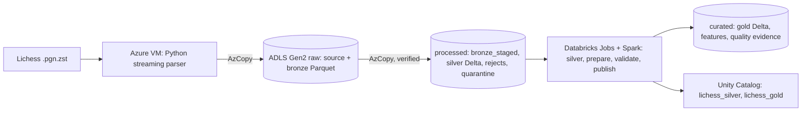

# DSAI3202 Phase 1: Lichess game-outcome data pipeline on Azure

**Student:** Rizan Mohammed (60306369), individual project  
**Submitted release:** Git tag `phase1-submission` (the commit it points to is the submitted version)  
**Instructor access:** the instructor is added as a collaborator on this repository

## Project and hypothesis

**Problem.** Predict the result of a Lichess game (White win, draw, Black win) after the first **10 moves per player (20 plies)**, using only information available at that point.

**Target.** `label`: 0 = White wins (`1-0`), 1 = draw (`1/2-1/2`), 2 = Black wins (`0-1`).

**Hypothesis (Phase 0).** H1: a gradient-boosted classifier using ratings, time control, ECO/opening and early clock usage achieves lower multiclass log loss than a rating-only logistic regression on later, unseen games (improvement of at least 0.005 with a bootstrap 95% CI excluding 0). H0: these extra features give no measurable improvement.

**Baseline plan.** Majority class, multinomial logistic regression on `elo_diff`, rating-only gradient boosting, then feature-group ablations. Chronological split (earlier games train, later games test) using `game_ts`.

**Approved refinements.** None so far.

**Known gap against Phase 0 (needs a decision).** The secondary timing experiment compares 5, 10 and 15 moves per player. Bronze keeps only the first 20 plies, so the 15-move checkpoint (30 plies) is not available yet. Planned fix: re-parse with 30 plies in Phase 2, or ask the instructor to approve dropping the 15-move checkpoint. The main hypothesis (move 10) is unaffected.

## Dataset and architecture

| Item | Value |
|---|---|
| Source | Lichess Open Database, standard rated games, **May 2017**: https://database.lichess.org/standard/lichess_db_standard_rated_2017-05.pgn.zst |
| Format | PGN compressed with Zstandard (`.pgn.zst`) |
| Compressed size | 3,585,539,491 bytes (3.34 GiB) |
| Games | 11,693,919 parsed (0 unparseable) |
| SHA-256 | `c4b2e39a382fb8a9dc5e766bbae0201d123c5c0ccc27f6e852d9a69e6661ab2f` |
| Source ETag / Last-Modified | `"63657a0d-d5b6fda3"` / Fri, 04 Nov 2022 20:46:05 GMT |
| Ingestion mode | Batch, started manually; refresh strategy: one new monthly file per run (new versioned raw path and manifest) |
| Uncompressed size | Larger than the 3.34 GiB compressed file, so the roughly 1 GB requirement is met; all 11,693,919 games were ingested and profiled |
| Data access | Azure Storage account `amazonlake60306369` (resource group `rg-dsai3202-rizan-60306369`), containers `raw`, `processed`, `curated`; reading needs the Storage Blob Data Reader (or Contributor) role and `az login`. The data is not in Git; the source manifest with its hash is in `evidence/ingestion/source-manifest.json` |

### Architecture



| Service | Role |
|---|---|
| Azure VM (Ubuntu) | Receives the 3.3 GiB file, hashes it, parses PGN in one streaming pass into Parquet |
| ADLS Gen2 (`amazonlake60306369`) | `raw`: source and bronze (as received/parsed). `processed`: silver and per-run work. `curated`: gold, features, evidence |
| AzCopy | Idempotent uploads (`--overwrite=false`) |
| Azure Databricks (Jobs, Spark) | The four-task ETL and quality gate |
| Unity Catalog | Registers `lichess_silver` and `lichess_gold` |

**Why bronze copy in processed?** Bronze is in `raw` as the lecture defines. The Databricks compute cannot read `raw` (`INSUFFICIENT_PERMISSIONS`), so a verified copy sits in `processed/lichess/bronze_staged/`, the same pattern as Lab-4 (raw to processed) then Lab-5.

### Storage layout

```
raw/lichess/standard_rated/2017-05/   lichess_db_standard_rated_2017-05.pgn.zst, source-manifest.json
raw/lichess/bronze/month=2017-05/     part-00000..00058.parquet (59), _bronze-manifest.json
processed/lichess/bronze_staged/month=2017-05/   copy of bronze + _source-manifest.json
processed/lichess_silver/                         Delta (table lichess_silver)
processed/lichess_silver_rejects/run_id=<uuid>/   rejected games with reason and raw record
processed/lichess_runs/<job run id>/              input copy, quarantine
curated/lichess_gold/                             Delta (table lichess_gold), current
curated/lichess_features_v1/                      Parquet, current
curated/lichess_runs/<job run id>/                gold, features per run
curated/quality/lichess_runs/<job run id>/        input.json profile.json gate.json coverage.json comparison.json success.json
curated/quality/lichess_drop_report.json          silver report
```

### Schema, keys and assumptions (silver / gold)

Key: `game_id` (Lichess id from the `Site` header), unique per game (0 duplicates found).

| Column | Type | Meaning |
|---|---|---|
| game_id | string | Lichess game id (key) |
| event | string | Event header (rated game type or tournament) |
| result | string | `1-0`, `0-1`, `1/2-1/2` (target source; never a feature) |
| utc_date | string | Game date `YYYY.MM.DD` |
| game_ts | timestamp | Start time (UTC) from UTCDate + UTCTime |
| white_elo, black_elo | int | Ratings before the game |
| white_diff, black_diff | int | Rating change after the game (leakage; never a feature) |
| eco, opening | string | Opening code and name |
| time_control | string | `base+increment` seconds, or `-` for untimed |
| tc_base, tc_inc | int | Parsed time control |
| termination | string | How the game ended (leakage; never a feature) |
| n_plies | int | Total plies in the game (leakage; never a feature) |
| moves20 | array<string> | First 20 plies (SAN) |
| clocks20 | array<int> | Seconds left after each of those plies |
| label (gold only) | int | 0 White win, 1 draw, 2 Black win |

Assumptions: the monthly file also holds a few hours of the previous month (`outside_month`, quarantined); a game's opening name is assigned by Lichess from the moves, so a few deep opening names may reflect moves beyond ply 20 (leakage risk, see below).

### Lineage

source `.pgn.zst` (sha256 in `source-manifest.json`) -> `parse_lichess.py` -> bronze Parquet (`_bronze-manifest.json`: 11,693,919 games) -> staged copy (byte sizes verified) -> `lichess_silver` (drop report: 11,687,692 rows) -> run input copy (`input.json`) -> `lichess_gold` + `features_v1` (`success.json`). `success.json` carries `source_sha256` and `bronze_games_parsed`.

## Run the pipeline

**Prerequisites.** Azure subscription with the lab resource group and lake; the Lab-2 VM; Databricks workspace with Unity Catalog (`dsai3202_databricks.s_60306369`); the instructor-granted data roles. `pip install -r requirements.txt` on the VM (`zstandard`, `pyarrow`).

**1. Ingest (VM).** Copy the `.zst` to the VM (`scp`), then:
```bash
mkdir -p ~/Lab-Phase1/{src,evidence,bronze}; cd ~/Lab-Phase1
sha256sum src/lichess_db_standard_rated_2017-05.pgn.zst | tee evidence/source.sha256
# write evidence/source-manifest.json (url, bytes, sha256, ETag, Last-Modified); then:
export AZCOPY_AUTO_LOGIN_TYPE=AZCLI; source ~/.config/dsai3202/lab3.env
B="https://$SA.blob.core.windows.net/raw/lichess/standard_rated/2017-05"
azcopy copy src/*.zst "$B/" --overwrite=false ; azcopy copy evidence/source-manifest.json "$B/" --overwrite=false
python3 -m venv .venv && .venv/bin/pip install -r requirements.txt
nohup .venv/bin/python src/ingest/parse_lichess.py src/lichess_db_standard_rated_2017-05.pgn.zst bronze/month=2017-05 > evidence/parse.log 2>&1 &
# upload bronze to raw, then the staged copy to processed (same azcopy --overwrite=false), then verify sizes
```
Verification and retry evidence is in `evidence/ingestion/` (hash round-trip, receipts before/after, `SIZES MATCH`, `STAGED MATCHES RAW`).

**2. ETL (Databricks).** Import `notebooks/lichess_*.py` into one workspace folder. Run `lichess_00_common` once. Create a job with four notebook tasks on one compute, no retries, no schedule, concurrency 1:

| Task | Notebook | Depends on (Run if) |
|---|---|---|
| silver | `lichess_01_silver` | none |
| prepare | `lichess_02_prepare` | silver (all succeeded) |
| validate | `lichess_03_validate` | prepare (all succeeded) |
| publish | `lichess_04_publish` | validate (all succeeded) |

Job parameters: `lake=amazonlake60306369`, `catalog=dsai3202_databricks`, `schema=s_60306369`, `run_id={{job.run_id}}`, `month=2017-05`, `test_bad_data=false`, `compare_to=` (empty). Exported configuration: `job/job-export.json`. Safe rerun: Run now with different parameters, `compare_to=<successful run id>`. Controlled failure: `test_bad_data=true`.

**3. Inspect.** `lichess_05_inspect` reads the saved evidence (cells 3.1 to 6.1).

## Results and features

### Runs

| Purpose | Job run ID | Outcome |
|---|---|---|
| Success | `1022222200504518` | All four tasks passed; published |
| Safe rerun | `681959495558867` | `SAME CONTENT`: gold and features identical to the success run (11,129,109 rows) |
| Controlled failure | `1040472147064037` | `test_bad_data=true` builds a separate test input (a copy of the saved input with one result changed to `2-0`, inside this run only); gate failed on `result`; publish did not run; `BLOCKED SAFELY` (published gold version and contents unchanged) |
| Real gate failure (fixed) | `455376947516555` | Gate failed on `time_control`: my rule rejected base 0 (`0+1`), which Lichess allows. Rule corrected; rerun passed |

Outputs of the success run: gold `curated/lichess_runs/1022222200504518/gold` (Delta), features `.../features`, `lichess_gold` version 1 after run 1 (each publish also writes a comment, so versions advance by 2 per run with identical content). `lichess_silver` is at version 6: earlier versions are identical rewrites from reruns.

### Row accounting

| Stage | Rows | Share |
|---|---|---|
| Bronze (parsed games) | 11,693,919 | 100% |
| Invalid: result not in {1-0, 0-1, 1/2-1/2} | 6,227 | 0.053% |
| Invalid: game id, Elo, timestamp, time control; duplicates | 0 | 0% |
| **Silver** | **11,687,692** | 99.947% |
| Quarantined as ineligible for the 20-ply prediction | 558,583 | 4.78% of silver |
| **Gold / features** | **11,129,109** | 95.22% of silver |

Balance checks printed by the job: `11,693,919 = 11,687,692 + 6,227 + 0` (silver task) and `11,687,692 silver = 11,129,109 gold + 558,583 quarantined` (publish).

Quarantine reasons (rule `eligibility`, `gate.json` of run `1022222200504518`): `too_short` 492,297 (4.21% of silver), `untimed_game` 36,476 (0.31%), `outside_month` 29,810 (0.26%), `incomplete_clocks` 0. Total 558,583 (4.78%, tolerance 15%). Every game with at least 20 plies had a clock value for each of those plies, so clock coverage was complete. `coverage.json` counts 36,565 untimed games in silver; 89 of them are also outside the month and are counted once, under `outside_month`, because each game gets the first reason that applies.

### Quality gate

Fail rules: schema, volume, keys, result, elo_range, timestamp, time_control, plies_arrays, unique_game. Quarantine rule: `eligibility` (at most 15% of silver). Warn rule: `clock_gap` (at most 10%). A failed rule raises an error in `validate`, so `publish` (Run if = All succeeded) never runs. Silver keeps every valid game; ineligible games are never deleted, only set aside with a reason.

### Exploratory analysis (all games, no sample; `coverage.json`)

- **Classes:** White 5,502,211 (49.44%), Black 5,187,163 (46.61%), draw 439,735 (3.95%). The majority-class baseline is about 49.4% accuracy; the prior-only log loss is about 0.83 nats (computed from these shares).
- **Rating signal:** correlation between `elo_diff` and a White win is 0.31. `elo_diff` quantiles (1/25/50/75/99%): -1794, -75, 0, 73, 1787. The heavy tails are mismatched games; use clipping or robust handling.
- **Time controls:** bullet 3,212,374, blitz 5,294,001, rapid 2,437,078, classical 185,656 games in gold. Mean Elo falls from 1,719 (bullet) to 1,490 (classical). White win share is 49.2% to 49.7% in every class.
- **Who is lost in eligibility (retention):** draws 97.7% vs White wins 94.8% and Black wins 95.5%; bullet 96.7%, blitz 95.8%, rapid 93.7%, classical 91.0%. All 36,565 untimed games (`-`) are excluded. Slower games and decisive results lose more games, so the modelled population over-represents long, drawn-out games and fast time controls (selection bias, see risks).
- **Clock data:** 3.0% of games start with unequal clocks (berserk or odds); no feature has missing values.
- **Readiness:** no missing feature values; 11.1M rows is ample for gradient boosting; draws are rare (3.95%), so use log loss and class-aware evaluation, not accuracy. Expect the rating baseline to be strong, so the 0.005 log-loss threshold for H1 is demanding.

### Features (v1, saved to `curated/lichess_features_v1`)

19 columns, defined in `FEATURES.md` (definition, type, source, availability at prediction time): ratings and rating difference/mean, time control and speed class, ECO/opening family, first clocks, seconds used over the first 10 moves, clock-use difference, unequal-start flag, plus `game_id`, `game_ts` (for chronological splits) and the label.

**Leakage risks:** `white_diff`, `black_diff`, `termination`, `n_plies` and `result` are never features (known only after the game). The opening name is assigned by Lichess from the moves and may include moves after ply 20 for deep lines; the Phase 2 ablation will test this. Eligibility requires 20 plies, which is known at move 10 in live use, but it removes early endings from training and evaluation. Only one month is used, so the chronological test set is the last days of May 2017.

## Resource use and contributions

**Cost/performance choice (measured).** Parse once on the VM with a streaming Zstandard reader instead of splitting games into small files or loading the file in Spark (`.zst` is not splittable). Measured: 6,100 games/s (200,000-game parts every ~32.5 s), about 32 minutes for 11.69M games, and the Parquet bronze is 736,859,702 bytes, 4.9 times smaller than the 3,585,539,491-byte source because only headers and the first 20 plies are kept. Publish took 198.7 s (`success.json`). A first silver run in the job was killed for memory (executor loss, code 52); I stopped caching in memory, built the raw-record JSON only for rejected rows, and raised shuffle partitions; the next run completed.

**Cost view (Azure Cost analysis, scope `rg-dsai3202-rizan-60306369`, 19 Oct to 6 Nov 2026, read on 6 Nov 2026):** actual cost USD 13.48 for the whole lab resource group since 19 Oct, covering all labs, not only Phase 1; forecast USD 14.21; no budget set. By service: Virtual Machines 8.52, Virtual Network (the VM's public IP) 2.22, Storage 1.51, Container Registry 1.18, Load Balancer 0.04, all others under 0.01. Everything is in Qatar Central. Databricks compute does not appear in this scope's view. The VM is the largest cost and runs only for ingestion, with daily auto-shutdown at 22:00 Qatar; the Standard public IP keeps billing while the VM is deallocated. The lake itself costs about USD 0.19.

**Cleanup.** Databricks compute terminated after the runs; VM auto-shutdown at 19:00 UTC (22:00 Qatar); lake and evidence kept for Phase 2; no resources deleted.

**Contributions.** Individual project: all work by Rizan Mohammed.

**Reused code and adaptations.** Lab-3 (AzCopy upload with `--overwrite=false`, manifests, receipts), Lab-5 `01_silver` (contract, row accounting, Delta table, `SAME CONTENT`), Lab-6 (`00_common`, `01_prepare`, `02_validate`, `03_publish`, `04_inspect`: job structure, saved input copy, quality gate with fail/quarantine/warn policies, `compare_to`, controlled failure). Adaptations: PGN parser (own), Lichess contract and eligibility rules, 20-ply features, fingerprint comparison instead of `exceptAll` (11M rows with arrays), `result` corruption for the failure test, four-task job with the cleaner first.

## AI use

| Tool | What I asked | What it returned | What I changed |
|---|---|---|---|
| DeepSeek | What a `.pgn.zst` file is and whether it can be converted to Parquet in a Databricks pipeline | Explained Zstandard PGN, that it is not splittable in Spark, and suggested decompress, shard, parse, write Parquet | Used for understanding only; changed nothing |
| Claude | Guidance for ingestion, automated ETL and quality for the Lichess dataset, following the lab structure; then notebook design | Ingestion commands, a streaming PGN parser, Databricks notebooks adapted from Lab-5/Lab-6 (`lichess_00` to `lichess_05`), job setup steps, troubleshooting | Chose the month and layout (bronze in raw, silver in processed, gold in curated); ran and verified every step; kept bronze in raw with a staged copy in processed because of Databricks permissions; fixed a gate rule (`time_control` base 0) and a memory problem found in real runs; replaced the exact row comparison with a fingerprint for scale; wrote the analysis |
